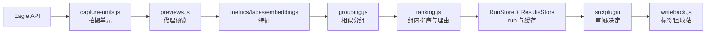

# Eagle Culling v1.0 架构

服务默认绑定 `127.0.0.1:43125`，Eagle API 默认 `127.0.0.1:41595`。Node 服务、CLI 和插件共享 `src/core` 的分析合同。

## 模块图



## 模块职责

- `eagle-api.js`：探测 Eagle v1/v2、读取 library/items、更新标签、移入回收站并校验 library。
- `metrics.js`：遍历 Eagle `.info` 目录，读取 `metadata.json`，计算 SHA-256、pHash、清晰度、曝光、尺寸和启发式质量指标。sharp 并发默认 2，由 `EAGLE_SHARP_CONCURRENCY` 覆盖到 1–8。
- `capture-units.js`：按文件名主干分组；可预览扩展名为 jpg/jpeg/heic/png，RAW 为 arw/dng/3fr/cr2/cr3/nef/raf/orf/rw2。唯一候选按拍摄时间和尺寸配对，否则标记 ambiguous。
- `previews.js`：缓存归一化代理图；macOS HEIC 使用 `sips`，普通图像使用 sharp，RAW 只使用 Eagle 缩略图。
- `faces.js` / `embeddings.js`：调用本地 MediaPipe worker 和 DINOv2 ONNX embedding。
- `grouping.js` / `ranking.js`：相似分组、质量排序、中文理由和 suggested 决定。
- `run-store.js` / `decisions-store.js`：持久化 run 和人工决定；`writeback.js`：幂等标签写回和可选回收站。
- `src/plugin/`：分析启动、逐组审阅、快捷键、dry-run/写回对话框和报告链接。

## 数据流

Eagle → capture units → previews → metrics/faces/embeddings → grouping → ranking → run store → plugin → writeback。HTTP 入口在 `src/server.js`、`src/server/runs-routes.js` 和 `src/server/review-routes.js`；合同细节见 `docs/contracts.md`。

## run 与缓存目录

```text
data/runs/<id>/
├── run.json          # 状态、libraryPath、计数、进度、警告
├── results-index.json # 新格式偏移索引和组摘要
├── results-<generation>/*.jsonl # 不可变分片
├── checkpoints.jsonl # 阶段/单元续跑日志
├── results.json      # 旧格式只读兼容
└── decisions.json    # 人工决定（有过决定时生成）
data/cache/
├── results.jsonl     # 旧 fingerprint 缓存只读偏移索引
├── results-v2/*/*.json # 新 fingerprint 缓存，原子单记录文件
├── native-mid/*.jpg # 本机看图器高清缓存，默认长边 6144、2 GiB LRU
├── previews/*.jpg    # 归一化代理图
└── embeddings/*.json # embedding 向量
```

新 run 在保存 units/results/groups/items 时流式写入不可变 JSONL 分片，并原子发布轻量索引；服务重启后可恢复。分析 fingerprint 由路径、size、mtime、itemIds、代理路径和 `analysis-v3` 组成；命中后跳过单元分析。代理缓存按源路径、size、mtime 生成键，损坏或像素近乎全平时重建。

## 分组和排序默认值

`grouping.js` 默认 pHash/dHash 距离 10、embedding 相似度 0.78、时间窗 3 秒、序号窗 4、时间 bonus 0.08、序号 bonus 0.06、最小配对分 0.52、平均相似度 0.5、组大小上限 100。`ranking.js` 权重为清晰度 0.30、曝光 0.20、眼睛 0.15、quality 0.20、aesthetic 0.15。

## 进程模型

Node CLI 或 HTTP 服务负责 Eagle 访问、文件发现、代理、指标、分组和写回。可选 Python worker 是独立 JSONL 子进程；人脸 worker 默认池大小 2、空闲 30 秒退出、超时 60 秒。缺少 worker 或模型时人脸结果不可用，其余分析继续。

## 扩展点

`AnalysisPipeline` 可注入 `analyzer` 和 `ResultsStore`。`src/core/scorer.js` 是 scorer 适配器边界：只有 `ml/scorer/infer.py` 与 `models/scorer` 都存在且推理成功才返回 calibrated 分数，否则 quality/aesthetic 固定 0.5、`calibrated=false`。模型评测见 `docs/model-eval.md`。

## L1 本地学习基础设施（2026-10-11）

`RunStore.save` 在 completed run 保存后复用结果建立 `LearningData` 特征索引；
审阅决定仍通过 `DecisionsStore` 原子更新，独立追加事件，失败不破坏选片。
`feature-store.js` 以内容 SHA-256 留住 DINO/指标/人脸/EXIF；`event-log.js` 保存不可变快照和曝光；
`preference-head.js` 只在特征上训练 signed BT；`preference-store.js` 保存 profile/快照/验证证据。
`server/learning-routes.js` 接入默认关闭的审阅面板；删除检测只读取完整受保护 Eagle 库存。
档 1 像素复制由 `pixel-retention.js` 串行执行，默认档 0，不运行额外视觉模型。
学习文件放 runs 根目录同级的 `learning/`，生命周期与 Eagle/run 原片解耦；协议见 contracts。
L0 与旧四指标路径保留；L1 需两窗口时间留出 bootstrap 稳定提升并显式应用，不跨硬门槛层重排。

## W8 第二轮：审阅热路径

RunStore 按 results 文件的 inode、size、mtime、ctime 缓存并合并读取，最多保留两个 run；
内部只读审阅路由共享分析数组，默认 get/results 仍返回脱离缓存的副本。原子替换或其它实例
保存后失效，单元图像索引仍叠加最新分组覆盖。LearningData 按分析数组身份及 run、库、
分组／AI 排序、照片路径／元数据、unit 映射和 fingerprint 复用特征映射，避免每次决定
重新遍历提特征并写 groups 索引。不同 run 不能因共享数组而丢失特征上下文。

决定仍按 run 串行，decisions 原子替换及学习事件追加完成后才返回 200；没有异步丢弃
事件或把未持久化状态提前确认。Server-Timing 分别记录 run 读取、decisions 写入、learning
阶段（含 profile 读取）。decisions.json 仍全量原子写入，实测阶段耗时用于判断是否有必要
进一步引入 journal，本轮没有改变文件格式。feedback 对日志／词表按文件版本缓存，追加
按路径跨实例串行，返回副本，保留理由修订、undo 和损坏日志报错。学习组先按 profile 过滤。

UI 状态使用只读索引，按卡片内容差异更新 DOM，保留未变化的图片节点；旧版偏好横幅
只在停止操作 5 秒后拟合，显式 refresh API 仍可立即等待。L1 面板手动训练／应用不去抖。
用于 QA 的 `culling:decision-rendered` 事件在收到持久化响应并更新 DOM 后发送；它不替代
事件日志。模拟器增量读取 JSONL 证据并精简重复响应，避免同进程报告采集制造 GC 延迟。

## W10 结果规模边界

审阅首屏按 20 组加载；组摘要、单组/单元、图像和报告路径不物化新格式的完整结果。
报告按页读取并服从 HTTP backpressure。扫描与分析检查点独立于终态结果，取消后可续跑。
分析/分组及全 run 学习、修组的兼容接口仍保留数组；十万单元的完整模型分析内存尚未验证。
统一生产资源调度和不可变 generation 自动回收仍未完成；详见 contracts/testing 的 W10 节。
